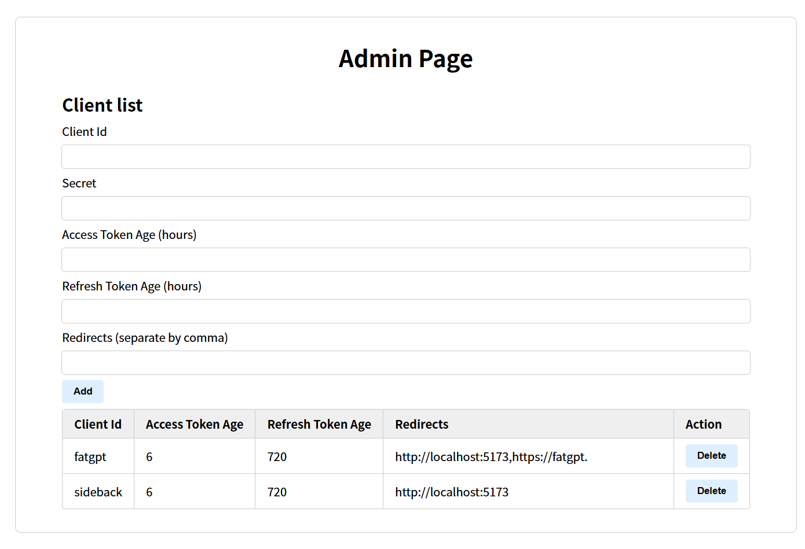

# MyOAuth

Self-hosted OAuth2.0/OIDC provider, with PKCE support.

Note: This is the side-project of other side-projects, coding style is bad.

## Setup

### Back End

Copy `conf.example.json` to `conf.json` and edit it to configure the
backend-related settings.

Generate RSA keys (defaults to `conf.json` `rsaPrivateKeyPath` so it works
without extra key-path configuration):

```shell
bash scripts/gen_keys.sh
```

Build and run (the frontend is embedded, see below):

```shell
make build
./myoauth   # ./myoauth.exe on Windows
```

Point at a custom config file with the `-conf` flag or the `MYOAUTH_CONF`
environment variable (flag wins over env, env wins over the default
`./conf.json`):

```shell
./myoauth -conf /path/to/conf.json   # ./myoauth.exe on Windows
MYOAUTH_CONF=/path/to/conf.json ./myoauth
```

### Front End

The SPA is served same-origin from the Go binary: it calls the API at the same
origin (`BASE` is `""` in production) and the server responds directly, so no
backend URL needs to be configured. The `/api/*` prefix is used only in local
development, where Vite proxies it to the backend (see below).

The built frontend is embedded into the Go binary, so a normal `make build`
builds the frontend (Vite output goes to `web/dist`) and compiles the server
with the assets included. The frontend can still be built standalone:

```shell
npm --prefix frontend ci
npm --prefix frontend run build
```

For local development, run `npm --prefix frontend run dev`. Vite proxies
`/api/*` to the backend; set `VITE_DEV_PROXY_TARGET` to change the proxy target
(defaults to `http://localhost:20476`).

### Makefile targets

- `make web` – install frontend deps (if needed) and build into `web/dist`
- `make build` – build the frontend, then `go build -o myoauth$(GOEXE) .`
- `make test` – `go test ./...`
- `make vet` – `go vet ./...`
- `make docker` – build the container image (`myoauth:latest`)
- `make compose-up` – `docker compose up -d --build`
- `make compose-down` – `docker compose down`

## Docker

The `Dockerfile` builds the SPA with Vite, compiles the Go server with the
assets embedded, and ships a small `alpine` runtime as a non-root user. The
runtime user is pinned to **uid 100 / gid 101**, so host files that the
container reads or writes must be owned by / writable to `100:101`. The SQLite
database and log file live outside the image and must be mounted as a volume so
data survives container upgrades.

### Build and run with Compose

A ready-to-edit `docker-compose.yml` is provided:

```shell
# 1. Create the config from the Docker-specific example, then edit it.
cp conf.docker.example.json conf.json

# 2. Generate the RSA key (run via bash so it works on clones without +x).
bash scripts/gen_keys.sh oauth.private.pem

# 3. Create the data dir and hand both it and the key to the container user.
mkdir -p data
chown -R 100:101 data
chown 100:101 oauth.private.pem && chmod 640 oauth.private.pem

# 4. Start the stack.
docker compose up -d --build            # or: make compose-up
```

The stack mounts (see `docker-compose.yml`):

- `./data:/data` – persistent SQLite database and log file
- `./conf.json:/config/conf.json:ro` – read-only configuration
- `./oauth.private.pem:/config/oauth.private.pem:ro` – read-only RSA key

The server listens on `http://localhost:20476`; a `HEALTHCHECK` polls `/health`.
The healthcheck port is coupled to `httpAddress` in `conf.json` — if you change
one, change the other.

#### Config values that must be set

- **`adminPassword`** – `conf.docker.example.json` ships with the literal
  placeholder `REPLACE_ME_WITH_A_BCRYPT_HASH`, not a real hash. Replace it with
  a bcrypt hash of your own strong password before starting; the server refuses
  to start only on an *empty* value, so a placeholder would otherwise boot with
  an unusable admin login. Generate a hash with one of:

  ```shell
  # htpasswd (from apache2-utils / httpd-tools), cost 12:
  htpasswd -bnBC 12 "" 'YourStrongPassword' | tr -d ':\n'

  # or with the project's own helper:
  cat > /tmp/bcrypt.go <<'EOF'
  package main

  import (
      "fmt"
      "os"

      "github.com/zenpk/my-oauth/util"
  )

  func main() {
      hash, err := util.BCryptPassword(os.Args[1])
      if err != nil {
          panic(err)
      }
      fmt.Println(hash)
  }
  EOF
  go run /tmp/bcrypt.go 'YourStrongPassword'
  ```

- **`secureCookies`** – must be set to `true` whenever the server is served over
  HTTPS (the example ships `false` because it assumes local HTTP; with the
  HTTPS `oidcIssuer` placeholder, leaving it `false` would send session cookies
  without the `Secure` flag).

To use a different config path, override `command:` in `docker-compose.yml`. The
image's default `CMD` passes `-conf /config/conf.json`, and that flag takes
precedence over the optional `MYOAUTH_CONF` environment variable (see
`main.go`), so setting `MYOAUTH_CONF` alone has no effect.

### Build and run manually

```shell
docker build -t myoauth:latest .
docker run --rm -p 20476:20476 \
  -v "$PWD/data:/data" \
  -v "$PWD/conf.json:/config/conf.json:ro" \
  -v "$PWD/oauth.private.pem:/config/oauth.private.pem:ro" \
  myoauth:latest
```

The container's config must reference the mounted paths (`conf.docker.example.json`
already does): `dbPath` `/data/myoauth.db`, `logFilePath` `/data/my-oauth.log`,
`rsaPrivateKeyPath` `/config/oauth.private.pem`, and `httpAddress`
`0.0.0.0:20476`. No secrets are baked into the image; keys and `conf.json` are
supplied at runtime. The same ownership steps as the Compose section apply:
`chown -R 100:101 data` and `chown 100:101 oauth.private.pem && chmod 640
oauth.private.pem` (the key must be readable and `data/` writable by uid 100 /
gid 101).

## Screenshot



## OIDC Endpoints

- Discovery: `/.well-known/openid-configuration`
- JWKS: `/.well-known/jwks.json`
- Authorization endpoint: `/authorize` (Authorization Code + PKCE S256)
- Token endpoint: `/token` (`authorization_code` and `refresh_token` grants)
- UserInfo endpoint: `/userinfo`
- Login submit endpoint for hosted login page: `/auth/login`
- End session (RP-initiated logout) endpoint: `/logout`
- Token revocation endpoint: `/revoke` (RFC 7009)
- Token introspection endpoint: `/introspect` (RFC 7662)

`conf.json` supports these OIDC-related fields:

- `oidcIssuer`: issuer used in discovery + JWT issuer claim
- `oidcLoginUrl`: hosted login page URL used by `/authorize`

Rate limiting (applied to `/auth/login`, `/token`, and `/setup/admin-login`,
each with its own per-IP bucket) is controlled by:

- `rateLimitEnabled`: whether the limiter is active (default `true`)
- `rateLimitRequestsPerMinute`: token refill rate per client IP (default `30`)
- `rateLimitBurst`: maximum bucket size, i.e. allowed burst (default `10`)
- `rateLimitMaxKeys`: hard cap on tracked keys; new keys are denied once full
  (default `100000`), so memory cannot grow unbounded
- `trustProxy`: when `true`, the limiter trusts `X-Real-Ip` (preferred) or the
  right-most `X-Forwarded-For` entry to identify the client (default `false`).
  When `false`, forwarding headers are ignored and the socket peer is used, so a
  spoofed `X-Forwarded-For` cannot bypass the limiter. Set this to `true` only
  when running behind the bundled nginx, which overwrites `X-Real-IP` with
  `$remote_addr`.

A missing value keeps the default, so older `conf.json` files keep working.

`adminPassword` must be non-empty; the server refuses to start otherwise (an
empty value would make the admin session HMAC key empty).

## Forward auth (replaces oauth2-proxy)

MyOAuth can act as the forward-auth backend for nginx's `auth_request`
directive, replacing `oauth2-proxy`. nginx makes an internal subrequest to
`/oauth2/auth` for each protected request:

- **2xx (202)** – the request is allowed and the identity is exposed through
  response headers (`X-Auth-Request-User`, `X-Auth-Request-Preferred-Username`,
  `X-Auth-Request-Access-Token`) that nginx forwards to the upstream.
- **401** – the request is denied and nginx redirects the browser into the
  login flow (`/oauth2/start?rd=<original URI>`).

MyOAuth is an OIDC Relying Party of *its own provider*, running in the same
process. It performs the normal login → authorization-code + PKCE → token
exchange, then stores the OAuth tokens **server-side in SQLite** (`proxy_sessions`
table). The browser only ever receives an **opaque, high-entropy, HttpOnly session
id cookie** — the tokens never leave the server.

This design is required by `auth_request`: nginx never forwards a subrequest's
`Set-Cookie` to the browser, so a refresh that rotates tokens during the auth
subrequest could not update the browser cookie. With a server-side session the
`/oauth2/auth` subrequest rewrites the stored tokens in place and the *same*
cookie keeps working for the whole session lifetime.

- `/oauth2/callback` creates a `proxy_sessions` row (user UUID, display name,
  access token, refresh token, access expiry, absolute expiry) and sets the
  cookie to the row's random id.
- `/oauth2/auth` looks the session up by cookie; a missing/expired session is a
  `401`. If the access token has expired it refreshes it, updates the row, and
  allows the request — no `Set-Cookie` needed. An expired access token **with no
  refresh token** is a `401`, never a `202` with a dead token. Concurrent
  subrequests for the same session are serialised so exactly one refreshes and
  the rest reuse the refreshed token.
- `/oauth2/sign_out` deletes the session row, revokes its refresh token
  (`RevokeUserSessions`) and its outstanding access tokens
  (`TokenStore.RevokeAccessTokensByUserAndClient`), clears the cookie and
  redirects to a validated `rd`.

This is the second supported nginx deployment (the first is serving the OIDC
provider/SPA itself); see `nginx.forward-auth.example.conf` for a complete,
hardened location block.

Enable it with the `forwardAuth` object in `conf.json` (disabled by default, so
existing configs keep working unchanged):

| Field | Default | Meaning |
| --- | --- | --- |
| `enabled` | `false` | Turns the whole feature on. When `false`, `/oauth2/*` returns a JSON 404 and the server behaves exactly as before. |
| `clientId` | `"proxy"` | The OIDC client used by the proxy. If no active client with this id exists, one is created automatically on startup. |
| `clientSecret` | – | **Required** when enabled. Secret for the proxy client. |
| `cookieSecret` | – | **Required** and at least 32 characters when enabled. Derives the AES-256-GCM key for the short-lived encrypted **state** cookie (`/oauth2/start` → `/oauth2/callback` CSRF + PKCE). Generate with `openssl rand -hex 32`. |
| `cookieName` | `"_myoauth_proxy"` | Session cookie name (carries only the opaque session id). The short-lived state cookie is `<cookieName>_state`. |
| `cookieDomain` | `""` | Optional cookie `Domain` attribute. |
| `cookieSecure` | `false` | Sets `Secure` on the cookies; enable it when serving over HTTPS. |
| `sessionTtlSeconds` | `0` | Session lifetime. `0` derives it from the proxy client's refresh-token age. |
| `loginPath` | `"/oauth2/start"` | Starts the login flow (`rd` = return URL). |
| `callbackPath` | `"/oauth2/callback"` | OIDC redirect URI; also registered as the proxy client's allowed redirect. |
| `authPath` | `"/oauth2/auth"` | `auth_request` subrequest target (GET/HEAD). |
| `signOutPath` | `"/oauth2/sign_out"` | Clears the session and redirects to a validated `rd`. |
| `allowedRedirectDomains` | `[]` | Extra hosts accepted for an absolute `rd` return URL. `rd` may always be a relative path (e.g. `/app`); anything else falls back to `/`. |

All `/oauth2/*` subpaths other than the configured endpoints return a JSON 404,
so the reserved namespace never falls through to the SPA.

Security notes: the state value is compared in constant time, the callback
requires the encrypted state cookie to match, PKCE (`S256`) is always used, the
ID token is fully verified (signature, issuer, audience, expiry), and the `rd`
return URL is validated against open redirects (exact host / default-port match
against `allowedRedirectDomains`, userinfo rejected, control characters and
percent-encoded path separators rejected in relative paths). Usernames
containing control characters are rejected at registration, and header values
are sanitized before they are returned. Client-supplied `X-Forwarded-*` headers
are never trusted for identity.

**Header authorization:** upstreams must authorize on `X-Auth-Request-User`, the
immutable user UUID. `X-Auth-Request-Preferred-Username` is a mutable display
name and must not be used for access decisions. The nginx example blanks every
other `X-Auth-Request-*` header so clients cannot spoof identity.

If the forward-auth feature is enabled but its cookie codec cannot be built, the
server refuses to start rather than silently disabling the protection. The bare
`/oauth2` path returns a JSON 404 instead of redirecting to `/oauth2/`.

## Usage

Recommend using `sdks`.
